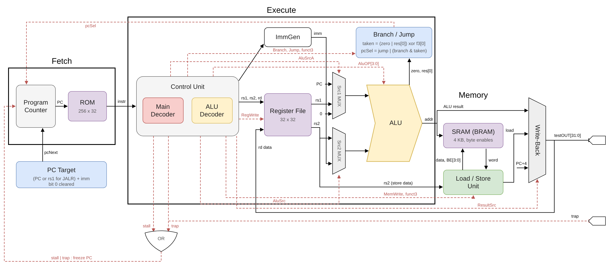

# RV32I-Alpha: Ultra-Low Area RISC-V Core for Artix-7

**RV32I-Alpha** is a resource-oriented 32-bit RISC-V processor designed for FPGA implementation on the **Digilent Basys 3**. It is intended as a compact experimental core for future work in **ASIC design** and **Near-/In-Memory Computing**.

## Architecture Overview

The core implements the **RV32I Base Integer Instruction Set**.

## Implementation Results (Basys 3 / XC7A35T)

| Metric | Value | Utilization % |
| :--- | :--- | :--- |
| **Logic Cells (LUT)** | **314** | **1.51%** |
| **Memory (LUTRAM)** | 44 | 0.46% |
| **Flip-Flops (FF)** | **32** | **0.08%** |
| **Block RAM (BRAM)** | 1 | 2.00% |
| **Total On-Chip Power** | **0.1 W** | **Ultra-Low** |
| **Dynamic Power** | 0.028 W | *--* |
| **Worst Negative Slack** | **0.165 ns** | **Timing Met @ 100 MHz** |
| **Maximum Frequency** | **101.7 MHz** | *--* |

---

## Comparison with Selected Open-Source RV32I Cores

> **Disclaimer:** The figures below are taken from the public repositories of each project. They are provided for **contextual positioning only**, not as a strict apples-to-apples benchmark, because FPGA families, tool versions, synthesis strategies, enabled features, memory systems, and SoC integration differ across projects.

| Core | ISA / Style | Published FPGA target / flow | LUTs | FFs / Regs | BRAM | Max Freq. | Link |
| :--- | :--- | :--- | ---: | ---: | ---: | ---: | :--- |
| **RV32I-Alpha** | RV32I, resource-oriented scalar core | **Basys 3 / XC7A35T / Vivado 2025.2** | **314** | **32** | **1** | **101.7 MHz** | [This repository](https://github.com/Badrodro/RV32I-Alpha-Ultra-Low-Area-RISC-V-Core-for-Basys-3) |
| **VexRiscv small** | RV32I, pipelined | Artix-7 / neutral synthesis | 504 | 505 | N/A | 243 MHz | [SpinalHDL/VexRiscv](https://github.com/SpinalHDL/VexRiscv) |
| **Rudi-RV32I** | RV32I, no pipeline | Artix-7 grade 1 FPGA | 575 *(CPU only)* | N/P | N/P | >80 MHz | [hamsternz/Rudi-RV32I](https://github.com/hamsternz/Rudi-RV32I) |
| **PicoRV32 (small)** | Configurable RV32I-family core | Xilinx 7-Series / area-optimized synthesis | 761 | 442 | N/P | N/P* | [YosysHQ/picorv32](https://github.com/YosysHQ/picorv32) |
| **Pequeno Light** | RV32I, 5-stage pipeline | Artix-7 xc7a35tcpg236-1 | 1076 | 552 | 0 | 114 MHz | [iammituraj/pequeno_riscv](https://github.com/iammituraj/pequeno_riscv) |

\* Upstream PicoRV32 publishes Xilinx 7-Series utilization for the small core, but the README timing number is reported separately for a different evaluated configuration/target, so it is intentionally not merged here.

> **Note on data integrity:** All implementation data for **RV32I-Alpha** is derived directly from Xilinx Vivado 2025.2 reports. To ensure transparency, screenshots and raw reports are available:
> - [View Utilization Report (314 LUTs)](assets/utilization_report.png) | [top_utilization_placed.rpt](reports/top_utilization_placed.rpt)
> - [View Power Analysis Report (0.1 W)](assets/power_report.png) | [top_power_routed.rpt](reports/top_power_routed.rpt)
> - [View Timing Summary (WNS 0.165 ns)](assets/timing_report.png) | [top_timing_summary_routed.rpt](reports/top_timing_summary_routed.rpt)

## Performance & CPI

To maintain very low resource usage, the core uses a dedicated stall mechanism to manage memory-related timing constraints.

- **General instructions:** ALU operations such as `add`, `sub`, and `xor`, as well as branch instructions, achieve a **CPI of 1**.
- **Memory operations:** Due to the synchronous nature of the SRAM and the integrated stall logic, the `LOAD` instruction **requires 2 cycles** (**CPI = 2**) to ensure correct data timing and avoid hazards. The `STORE` instruction completes in **1 cycle**.
- **Exception handling:** Native support for `ebreak` and `ecall` is provided through a dedicated **Trap** signal, allowing clean program termination and hardware-oriented debugging.

## Verification

Verification currently relies on a full-core simulation testbench and a ROM-resident torture test program designed to stress the main execution paths of the processor.

Validated aspects include:
- arithmetic and logical RV32I instructions
- branch and control-flow behavior
- load/store execution
- trap-based program termination (`ebreak`, `ecall`)
- stall behavior related to synchronous memory accesses

Main program used for end-to-end validation:
- [torture_test](asm/torture_test.s)

More advanced verification methods such as formal verification and finer-grain block-level testbenches are planned as future work.

## Roadmap

- **ASIC flow exploration:** Generate a first GDSII version of the core using OpenLane and the SkyWater 130 nm PDK.
- **Formal verification:** Integrate **riscv-formal** to strengthen ISA-level correctness checks.
- **Custom acceleration extension:** Explore a lightweight matrix-vector multiplication (MVM) unit for future Near-Memory Computing experiments.

## Contact

If you have any questions or suggestions about the project, feel free to contact me:

- **Email:** Badreddine_Benfettouma@etu.ube.fr

---

*Designed and verified with Xilinx Vivado 2025.2 by Badreddine BENFETTOUMA. I am currently a student at University of Bourgogne Europe, with research interests in digital system architecture and Near-/In-Memory Computing.*
