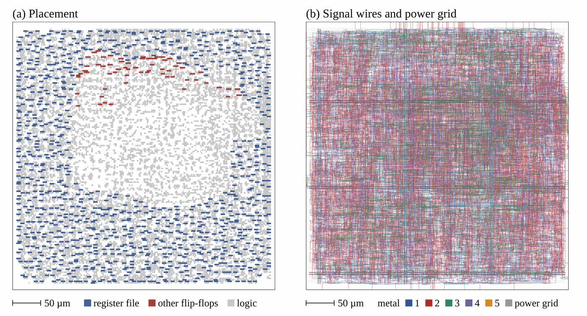

# RV32I-Alpha: a two-stage RISC-V core for the Basys 3 and SKY130

RV32I-Alpha is a 32-bit RISC-V core that implements the RV32I base integer instruction set.
It is written in VHDL; a SystemVerilog version is proven equivalent to it. The core is checked
with [riscv-formal](https://github.com/YosysHQ/riscv-formal), runs on a Digilent Basys 3
(Xilinx Artix-7), and has been placed and routed in the SkyWater SKY130 process with open-source
tools.

## Architecture

*Data paths in black, control signals in dashed red. Source: [assets/rv32i_architecture.svg](assets/rv32i_architecture.svg).*

- **Two stages.** IF sends `pc_if` to a synchronous instruction memory. The output register of that
  memory is the IF/EX pipeline register. EX decodes, reads the register file, executes, accesses
  data memory and writes back in the same cycle.
- **Hazards.** The register file is written at the end of EX and read by the next instruction after
  that clock edge, so there is no forwarding. Branches are predicted not taken: a taken branch or a
  jump kills the instruction fetched behind it.
- **ALU.** One 33-bit adder serves ADD, SUB, SLT, SLTU and the branch comparisons; one right shifter
  serves SRL, SRA and SLL. Equality is compared on the operands, in parallel with the adder.
- **Target adder.** `(pc_ex or rs1) + imm` serves the branches, JAL, JALR and AUIPC.
- **Memory ports.** Harvard interface. The data port holds a request until `dmem_gnt` is high, so a
  slower memory or an arbiter can insert wait states. The Basys 3 top ties `dmem_gnt` to 1.
- **Traps.** ECALL, EBREAK, every non-RV32I encoding, misaligned loads and stores, and jumps or taken
  branches to a misaligned target stop the core with no side effect (`trap` = 1). There are no CSRs
  and no interrupts. FENCE executes as a NOP.

| Instruction | Cycles |
| :--- | ---: |
| ALU, LUI, AUIPC, store, branch not taken | 1 |
| Branch taken, JAL, JALR | 2 (one bubble) |
| Load | 2 |
| Load or store with data-port wait states | + one per cycle with `dmem_gnt` = 0 |

## Verification

| Check | Tool | Depth |
| :--- | :--- | ---: |
| 37 instruction checks (`insn`), `ill` | riscv-formal (Yosys, SymbiYosys, Yices) | 10 |
| `reg`, `pc_fwd`, `pc_bwd`, `causal`, `unique`, `cover` | riscv-formal | 10 |
| `liveness` (at most two wait cycles in a row assumed) | riscv-formal | 15 |
| Instruction port: the retired instruction is the word fetched at its PC | SymbiYosys, `formal/memcheck.sv` | 16 |
| Data port, with random wait states: a load returns the bytes last stored at its address | SymbiYosys, `formal/memcheck.sv` | 10 |
| Every non-RV32I word traps, against an independent reference decoder | SymbiYosys, `formal/memcheck.sv` | 16 |
| VHDL and SystemVerilog versions are sequentially equivalent (1826 / 1826 cells) | Yosys `equiv_make`, `equiv_induct` | induction |
| Self-checking torture test passes in 197 cycles | GHDL | full program |

riscv-formal and the memory-port checks use bounded model checking: they show that no
counterexample exists within the stated number of cycles from reset, not correctness for every
execution. While the checks were written, 8 bugs were injected into the core one at a time
(SLTU computed as signed, no kill after a taken branch, no trap on a misaligned store, wrong link
address, no load stall, wrong illegal-instruction decode, instruction memory never disabled, wrong
SH byte lanes); each was caught by at least one check.

The torture test (`asm/torture_test.s`) covers the six branches (taken, not taken, equal
operands), LUI and AUIPC, every R-type and I-type ALU instruction, writes to `x0`, JAL and JALR,
every load and store width, back-to-back loads and the use of a value right after its load.

| Task | Command (from the repository root) |
| :--- | :--- |
| riscv-formal and memory-port checks (48 checks, about a minute on 4 cores) | `./formal/run.sh` |
| VHDL / SystemVerilog equivalence | `./formal/equiv_vhdl_sv.sh` |
| Torture test in simulation | `./scripts/sim.sh` |

All three run in CI on every push (*Actions* tab). `formal/run.sh` downloads riscv-formal at a
fixed commit.

## Implementation

### SKY130 (open-source flow)

*(a) Standard-cell placement, register-file flip-flops in blue. (b) Signal wires on met1&ndash;met4.
Drawn from the routed DEF by `asic/defplot.py`.*

| Step | Result |
| :--- | :--- |
| Synthesis (Yosys 0.62, sky130_fd_sc_hd, typical corner) | 4 696 cells, 59 557 &micro;m&sup2;; the register file is 992 flip-flops |
| Placement and detailed routing (OpenROAD) | die 375.8 &times; 375.8 &micro;m (0.141 mm&sup2;), 47 % utilization, 234 mm of wire, 42 237 vias, no violations reported by the detailed router |

Not done yet: power grid, clock-tree synthesis, timing repair and timing closure, sign-off DRC
and LVS, GDSII. The next step is a full LibreLane run. Commands and the source of each number:
[asic/README.md](asic/README.md).

### FPGA (Basys 3, XC7A35T)

`scripts/vivado_build.tcl` builds the bitstream for the board (core, BRAM instruction and data
memories, Pmod output of the write-back bus) and also synthesizes the core alone out of context.
Pin mapping (`constraints/Basys3.xdc`): `clk` on the 100 MHz oscillator, `reset` on BTNC, `trap`
on LED 15, and the last value written to a register on the four Pmod headers.

The script writes its utilization, timing and power reports to `reports/`. Vivado figures for
the current version are not published yet. Open-source estimate for the core alone
(`scripts/synth_report.sh`, Yosys 0.62 `synth_xilinx`, xc7; Yosys is usually larger than Vivado):
885 logic LUTs, 48 LUTs used as distributed RAM for the register file, 63 flip-flops.

## Repository layout

| Path | Contents |
| :--- | :--- |
| `src/` | VHDL core (`core.vhd`) and Basys 3 top level with its memories |
| `rtl/core/` | SystemVerilog version of the core |
| `tb/`, `asm/` | Testbench, torture test program and ROM generator |
| `formal/` | riscv-formal configuration, memory-port properties, equivalence script |
| `asic/` | SKY130 synthesis, place-and-route and plotting scripts |
| `scripts/` | Simulation, Vivado build and synthesis estimate scripts |
| `constraints/` | Basys 3 pin constraints |
| `assets/` | Architecture diagram and layout figure |

After editing the torture test, regenerate the ROM with `python3 asm/build_rom.py` (needs
`llvm-mc` and `llvm-objcopy`).

## Roadmap

- Full LibreLane run: power grid, clock tree, sign-off timing, DRC and LVS, GDSII.
- Vivado figures (area, timing, power) for the current version.
- The `rv32ui` tests from [riscv-tests](https://github.com/riscv-software-src/riscv-tests).

## Contact

Badreddine Benfettouma, Université Bourgogne Europe, Dijon, France.
Email: Badreddine_Benfettouma@etu.ube.fr
